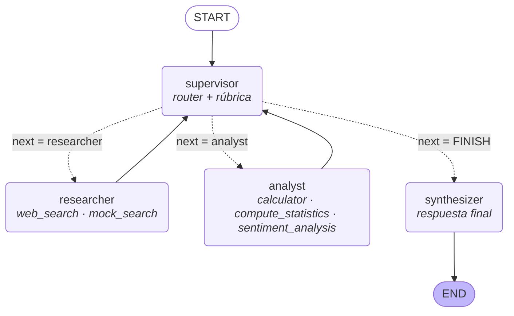

# Orquestador Multi-Agente de Análisis e Investigación

Prototipo de **orquestador jerárquico** con **LangGraph** y **Gemini**: un **Supervisor** enruta la consulta
del usuario entre especialistas (**Investigador** con búsqueda web vía Tavily y **Analista** con herramientas
de cómputo), valida los resultados con una **rúbrica** y cierra con una **síntesis final**.

> Pre-entrega 6 — AI Engineer (Coderhouse)

## Diagrama del grafo



PNG generado con `graph.get_graph().draw_mermaid_png()`: [docs/graph.png](docs/graph.png) (`python main.py --draw`).

## Estructura

```
├── state.py                 # Esquema de estado compartido (hereda de MessagesState)
├── llm.py                   # Factory de Gemini + fallback entre modelos ante 503/429
├── graph.py                 # StateGraph: nodos, aristas condicionales (Literal), run_stream()
├── main.py                  # CLI: ejecutar consultas, dibujar el grafo, ver créditos
├── agents/
│   ├── research_agent.py    # Agente de Investigación (create_react_agent + Tavily)
│   ├── analyst_agent.py     # Agente de Análisis (create_react_agent + herramientas de cómputo)
│   └── supervisor.py        # Supervisor (router + rúbrica) y nodo de síntesis
├── tools/
│   ├── search_tools.py      # web_search (Tavily con guardián de créditos) y mock_search
│   └── analysis_tools.py    # calculator (AST seguro), compute_statistics, sentiment_analysis
├── data/mock_corpus.json    # Corpus simulado para búsqueda offline
├── demo.ipynb               # Demo ejecutada del flujo de delegación
└── docs/graph.png           # Diagrama del grafo
```

## Cómo correrlo

```bash
python -m venv .venv
.venv\Scripts\activate            # Windows  (Linux/Mac: source .venv/bin/activate)
pip install -r requirements.txt
cp .env.example .env              # completar GOOGLE_API_KEY y TAVILY_API_KEY

python main.py                    # consulta de ejemplo (inflación Argentina)
python main.py "tu consulta"      # consulta propia
python main.py --max-steps 3 "…"  # cambiar el tope de pasos
python main.py --draw             # exportar docs/graph.png y docs/graph.mmd
python main.py --credits          # créditos Tavily consumidos
```

Sin `TAVILY_API_KEY` el investigador usa `mock_search` (corpus local), así que el flujo sigue funcionando.

## Estado compartido (`state.py`)

`OrchestratorState` hereda de `MessagesState` y agrega campos estructurados:

| Campo | Para qué |
|---|---|
| `user_query` | Consulta original: fuente de verdad que no se pierde en el historial |
| `next_agent` | Decisión del supervisor (`researcher` / `analyst` / `FINISH`) |
| `current_instruction` | Instrucción **acotada** para el especialista de turno |
| `validation_feedback` | Qué corregir cuando el supervisor pide un refinamiento |
| `research_findings` / `analysis_results` | Última entrega de cada dominio |
| `contributions` *(append-only)* | Quién aportó qué: agente, step, instrucción, output, tools usadas |
| `decisions` *(append-only)* | Log de cada decisión del supervisor (motivo, rúbrica OK, si fue forzada) |
| `step_count` / `max_steps` / `revision_counts` | Control anti-bucle |
| `task_completed` / `final_answer` | Cierre |

`contributions` y `decisions` usan el reducer `operator.add`, así cada nodo **agrega** registros sin pisar los anteriores: la trazabilidad completa queda en el estado.

## ¿Por qué una topología jerárquica (Supervisor)?

- **Control centralizado del flujo:** un único nodo decide quién actúa, así el recorrido es predecible y auditable (`decisions`).
- **Validación en un solo lugar:** el supervisor aplica la rúbrica antes de dar el `END`. No hace falta que cada agente se valide a sí mismo.
- **Especialistas simples y con herramientas acotadas:** el investigador **no** puede calcular y el analista **no** puede buscar. Cada uno hace una sola cosa, lo que reduce las alucinaciones y facilita testearlos.
- **Extensible:** sumar un especialista implica agregar un nodo, un valor al `Literal` y una línea en el prompt del supervisor.

Frente a una red *peer-to-peer* (agentes que se pasan el control entre sí), la jerárquica evita ciclos difíciles de controlar. Frente a un *pipeline* fijo, permite **volver atrás**: por ejemplo, si el analista detecta datos insuficientes, el supervisor reenvía al investigador.

## Supervisor: ruteo y validación

El supervisor usa `with_structured_output(SupervisorDecision)` con `next: Literal["researcher", "analyst", "FINISH"]`.
La función de ruteo (`route_from_supervisor`) devuelve un `Literal` con los nombres de los nodos para las aristas condicionales.

**Rúbrica (en el prompt), que se aplica antes de `FINISH`:**

1. **R1:** hay datos factuales de fuentes externas con URL citada.
2. **R2:** el análisis usa esos datos y los números salen de herramientas.
3. **R3:** los cálculos son coherentes con los datos.
4. **R4:** todas las partes de la consulta están cubiertas.
5. **R5 (recencia):** los datos son los más recientes respecto de la fecha de hoy, que se inyecta en el prompt.

Si un criterio falla, el supervisor delega al responsable con un `feedback` concreto. Eso es un **refinamiento**.

## Manejo de conflictos entre agentes

- **Datos insuficientes o contradictorios:** el analista no completa datos faltantes y responde `DATOS_INSUFICIENTES: …`. El supervisor reenvía al investigador con ese feedback.
- **Fuentes que no coinciden** (por ejemplo, 1,89 % vs 1,9 %): el investigador está obligado a reportar ambas con sus fuentes y a declararlo en *Limitaciones*. La síntesis lo informa.
- **Datos con fuente sobre interpretaciones:** el analista no tiene búsqueda, así que solo puede trabajar con lo que el investigador encontró. Si el léxico de sentimiento contradice el contexto, el analista lo matiza explícitamente (se ve en la demo).
- **Desacuerdo del supervisor con una entrega:** hay como máximo `MAX_REVISIONS = 2` refinamientos por agente. Pasado ese límite se cierra con lo disponible y se declara la limitación.

## Cómo se evitan los errores comunes

**Supervisor infinito.** Hay dos reglas de parada **en código**, que no dependen del LLM:

1. `step_count >= max_steps` (por defecto 8) fuerza `FINISH`.
2. `revision_counts[agente] > 2` fuerza `FINISH`.

Además, el prompt incluye un **criterio de suficiencia** ("no busques perfección") y se pasa un `recursion_limit` tanto al grafo como a cada sub-agente ReAct.

**Contaminación de contexto.** Los especialistas **no** reciben el historial completo de `messages`:

- El investigador recibe solo la `current_instruction` (más el feedback y su entrega previa si es un refinamiento).
- El analista recibe la instrucción y los `research_findings`.
- El supervisor ve un resumen estructurado (consulta, hallazgos, análisis y log de delegaciones), no los mensajes internos de las herramientas.

## Robustez y costos

- **Fallback de modelos Gemini.** Ante 503/429/504, `call_with_fallback` reintenta con el siguiente modelo de `GEMINI_MODEL` + `GEMINI_FALLBACK_MODELS`.
- **Créditos de Tavily** (`tools/search_tools.py`):
  - búsquedas con `search_depth="basic"` (1 crédito);
  - presupuesto global persistente (`TAVILY_CREDIT_BUDGET=1500`, contado en `.tavily_usage.json`);
  - tope de 4 búsquedas por ejecución;
  - caché por consulta (repetir una búsqueda cuesta 0).

  Si se alcanza un límite, el agente pasa a `mock_search`.

## Demo

[demo.ipynb](demo.ipynb) muestra, ya ejecutado:

1. **Caso 1:** supervisor → researcher → supervisor → analyst → supervisor (rúbrica OK) → synthesizer, con la tabla de `decisions` y `contributions`.
2. **Caso 2:** `max_steps=2`, donde la regla de parada fuerza el cierre después de la investigación.

## Stack

LangGraph 1.x · langchain-google-genai (Gemini 3.x Flash) · langchain-tavily · Pydantic · python-dotenv
